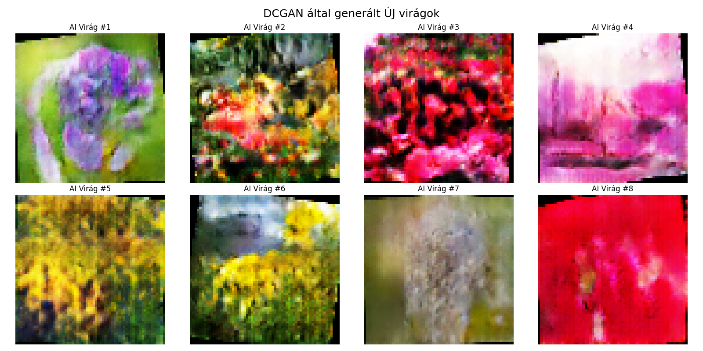
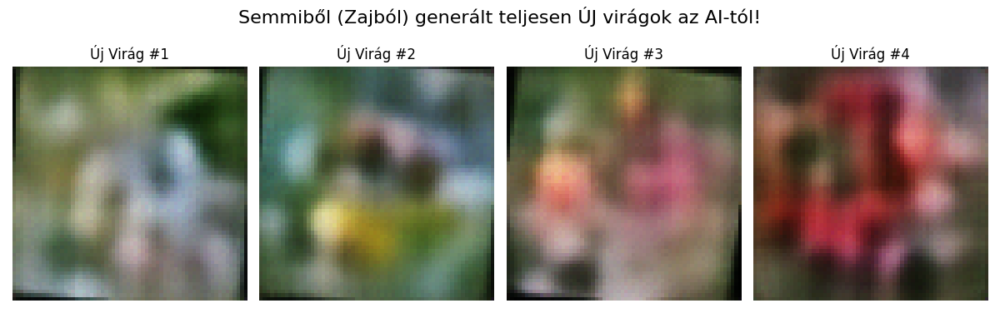

<h1 align="center">Gen_AI_DP3HYC</h1>

<p align="center">
  Two generative models learn to paint flowers.<br />
  <samp>PYTHON · PYTORCH LIGHTNING · TORCHVISION</samp>
</p>

### <samp>01 — WHAT IT IS</samp>

Two generative models trained to produce 64×64 flower images, built for a generative AI
class: a DCGAN and a variational autoencoder. Same data, same preprocessing, two very
different ways of learning what a flower looks like.

### <samp>02 — RESULTS</samp>

| DCGAN, generated | VAE, generated |
|---|---|
|  |  |

Every run writes its own timestamped folder under `eredmenyek/` with the loss curve and a
sheet of generated flowers. The VAE also saves a reconstruction comparison.

### <samp>03 — THE TWO MODELS</samp>

| | DCGAN | VAE |
|---|---|---|
| File | `ImageGeneratorDCGAN/FlowerGAN.py` | `ImageGeneratorVAE/FlowerGenerator.py` |
| Latent size | 100 | 128 |
| Generator / decoder | 5 transposed convolutions, 4×4 → 64×64, `tanh` output | Linear → 4 transposed convolutions, `tanh` output |
| Discriminator / encoder | 5 convolutions down to one sigmoid score | 4 convolutions → `mu` and `log_var` |
| Loss | Binary cross-entropy, generator against discriminator | Summed MSE reconstruction + KL divergence |
| Optimiser | Two Adam optimisers, lr 2e-4, betas (0.5, 0.999), stepped manually | Adam, lr 5e-4 |
| Training | 104 epochs | 20 epochs |

Both are PyTorch Lightning modules and were trained on CPU.

### <samp>04 — DATA</samp>

Images are loaded with `torchvision.datasets.ImageFolder` from `./flower_photos`, resized
to 64×64, randomly flipped and rotated by up to 10°, and normalised to [-1, 1]. Batch size
is 32. The dataset is not stored in this repository.

### <samp>05 — RUN IT</samp>

```bash
pip install torch torchvision pytorch-lightning pandas matplotlib
```

Put a `flower_photos/` folder (one sub-folder per class) next to the workflow you want to
run, then:

```bash
cd ImageGeneratorDCGAN
python Workflow.py
```

```bash
cd ImageGeneratorVAE
python Workflow.py
```

### <samp>06 — LAYOUT</samp>

| Path | What it is |
|---|---|
| `ImageGenerator*/Workflow.py` | Data loading, training, and saving the result figures |
| `ImageGenerator*/logs/` | Lightning CSV logs, hyperparameters and checkpoints per run |
| `ImageGenerator*/eredmenyek/` | Result figures per run |
| `ImageGeneratorVAE/TestResoults/` | An early 10-epoch test |

### <samp>07 — LICENCE</samp>

MIT. See [`LICENSE`](./LICENSE).

<br />

<p align="center">
  <a href="https://github.com/Deatron01"></a><br />
  <sub><i>Little chaos in a quiet mind.</i></sub><br />
  <sub><samp>MORE WORK AT <a href="https://github.com/Deatron01">GITHUB.COM/DEATRON01</a></samp></sub>
</p>
